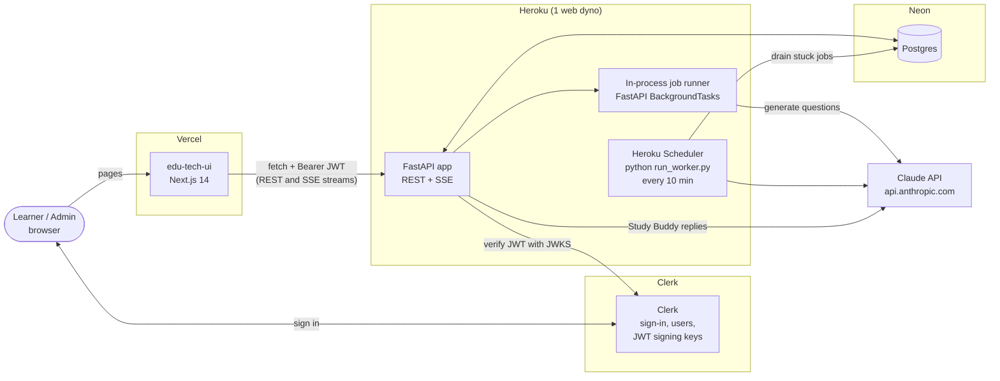
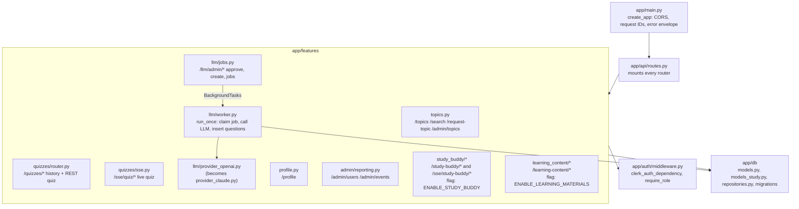
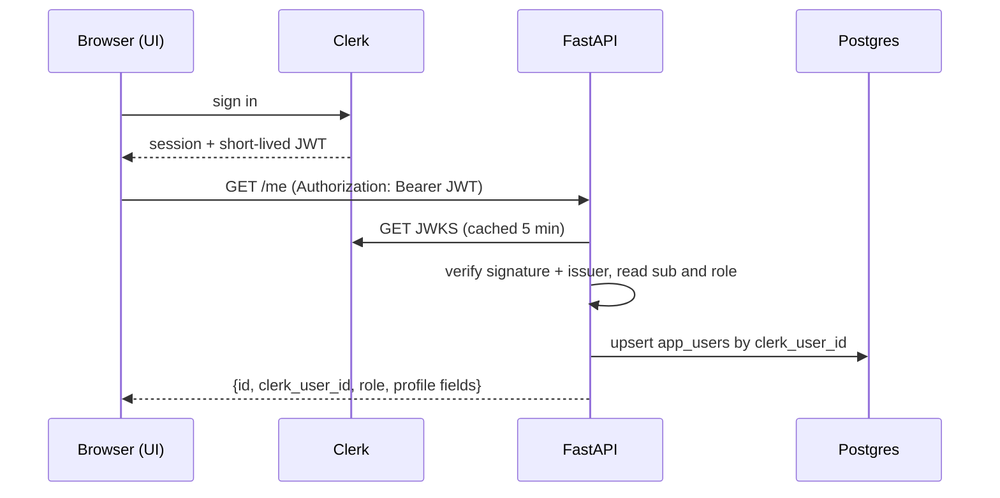
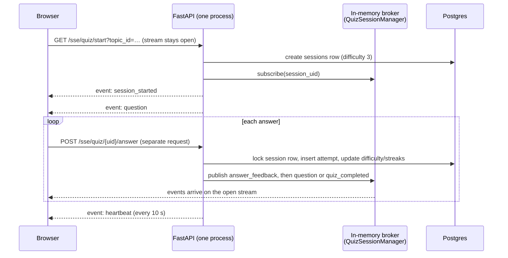
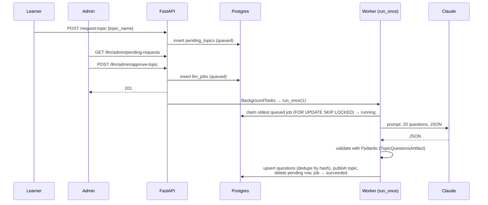
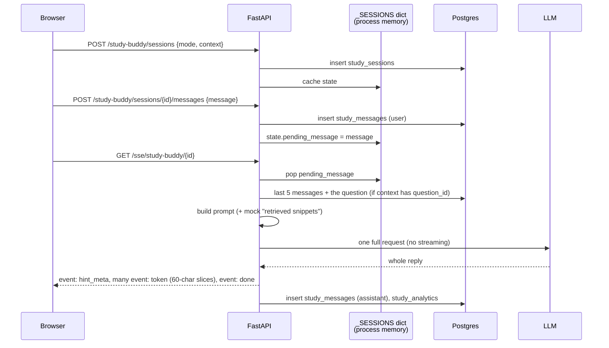

# Architecture

This page shows the target setup after the 2026 revival: Vercel, Heroku, Neon, Clerk and Claude. Where today's code still differs from it, the page says so and links to [revival-plan.md](revival-plan.md).

## 1. The big picture



What each part does:

| Part | Job |
|---|---|
| **UI** (Next.js) | Every page is a client component. It gets a Clerk token and calls the API with `fetch`. It has no database of its own. `src/app/api/*` holds only a health check and a mock list. |
| **Clerk** | Sign-up, sign-in and the user list. It signs a short-lived JWT (JSON Web Token: a signed piece of text that says who you are). The admin role lives in the user's Clerk `public_metadata`. |
| **FastAPI** | All business logic: topics, quizzes, profile, admin reports, Study Buddy. It checks each JWT against Clerk's public keys (JWKS), so it never needs to call Clerk per request. |
| **Job runner** | When an admin approves a topic, the API writes a row in `llm_jobs`. It then starts the worker right away as a background task in the same process. |
| **Scheduler** | A safety net. It runs the same worker every 10 minutes and picks up any job the API process dropped, for example because of a restart. |
| **Postgres** | The only store. Users, topics, questions, quiz sessions, answers, jobs, events and chat messages all live here. |
| **Claude** | Writes quiz questions (worker) and tutor replies (Study Buddy). Today the code calls OpenAI through LangChain. [revival-plan.md](revival-plan.md) step 4 swaps that for Claude. |

## 2. Inside the backend



Folder notes:

- `app/` is the live code. Start reading at `app/api/routes.py`.
- `worker/` and `run_worker.py`: `run_worker.py` calls `app/features/llm/worker.py`. The `worker/` folder is an older second worker. Only `tests/test_worker_smoke.py` uses it.
- `prompts/` holds the prompt text. The `.md` files are templates with `{{placeholders}}`.
- The `test_*.py`, `check_*.py`, `reset_migration.py` and `*_SUMMARY.md` files at the repo root are one-off debug scripts and status notes. Nothing imports them.

## 3. Request flows

### 3.1 Sign in and call the API



The first API call creates the user's row. No sign-up webhook is needed.

### 3.2 Take an adaptive quiz (live stream)



> **Important limit.** The broker is a Python dict in one process. The answer POST must reach the same process that holds the stream. So the API must run as **one process on one dyno**. Do not use `gunicorn --workers 2`, and do not scale to 2 dynos. Upgrade path: move the broker to Postgres `LISTEN/NOTIFY`.

### 3.3 Request a topic, approve it, generate questions



`SKIP LOCKED` makes two workers skip each other's rows. So the Scheduler and the in-process trigger can never pick up the same job.

### 3.4 Study Buddy chat (as built today)



The UI side is `HintChat` (`edu-tech-ui/src/components/quiz-hint-chat.tsx`), a quiz-mode chat panel on the quiz page. It works, but it has several weak spots: fake streaming, mock snippets, and state kept in process memory. [learning/04-chatbot.md](learning/04-chatbot.md) walks through fixing each one.

## 4. Response shape

Most JSON endpoints wrap results in an envelope (`app/auth/schemas.Envelope`):

```json
{ "success": true, "data": { ... }, "meta": null }
```

Errors go through `app/utils/errors.py`. Every response carries an `X-Request-ID` header, which you can match against the logs.
