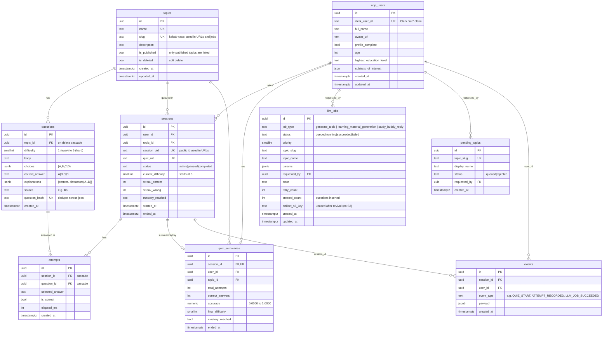
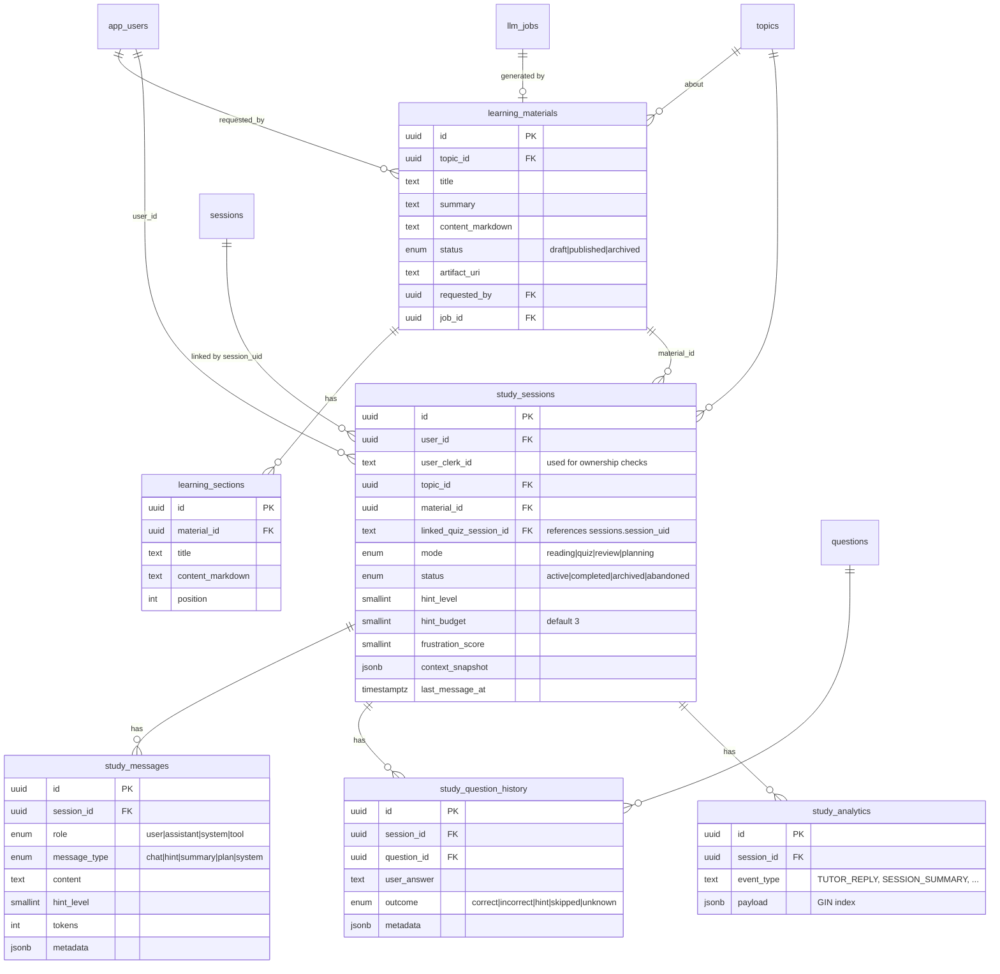

# Database

Postgres, hosted on Neon (see [decisions.md](decisions.md)). The schema is defined in two places:

- **Models:** `app/db/models.py` (core) and `app/db/models_study.py` (Study Buddy). The app reads and writes through these.
- **Migrations:** `app/db/migrations/versions/` (Alembic). These build the real tables. Current head: `0012_link_quiz_to_uid`.

Conventions: every primary key is a UUID made by `gen_random_uuid()`, which comes from the `pgcrypto` extension that migration 0001 turns on. Every timestamp is `timestamptz` and defaults to `now()`. Flexible data (answer choices, explanations, job params, event payloads) is stored as `JSONB`.

## 1. Core tables (quiz platform)



What each table is for:

| Table | Purpose | Written by |
|---|---|---|
| `app_users` | One row per Clerk user. **Roles are not stored here.** They come from the JWT on every request. | `clerk_auth_dependency` (upsert on each call), `/profile` |
| `topics` | The topic catalog. A topic shows up for learners only when `is_published` is true and `is_deleted` is false. | Worker (creates and publishes), admin endpoints |
| `questions` | Multiple-choice questions, five difficulty levels. `question_hash` stops the same question from being inserted twice. | Worker, `POST /admin/questions/import` |
| `sessions` | One quiz run. Holds the live adaptive state: difficulty, streaks, mastery. | Quiz service |
| `attempts` | One row per answered question. A unique `(session_id, question_id)` means a question is never repeated within a session. | Quiz service |
| `quiz_summaries` | Totals saved when a quiz ends, so history pages need no recount. | Quiz end/summary |
| `llm_jobs` | The job queue. The worker claims rows with `FOR UPDATE SKIP LOCKED`. | `/llm/admin/*`, `/learning-content/*` |
| `pending_topics` | Learner topic requests waiting for an admin. Deleted when the job succeeds. | `/request-topic` |
| `events` | Audit log for jobs and answers. Feeds the admin events page. | Everywhere |

## 2. Study Buddy and learning-material tables

These are used only when `ENABLE_STUDY_BUDDY=1` or `ENABLE_LEARNING_MATERIALS=1`.



`study_messages` is the chat history. Today the tutor reads only the last 5 rows, as plain text. The [chatbot guide](learning/04-chatbot.md) changes that so they are sent as real conversation turns.

`study_sessions.linked_quiz_session_id` holds the quiz's public `session_uid` (text), not `sessions.id`. Migration `0012_link_quiz_to_uid` made that change, so the UI can pass the same id it already has in the URL.

## 3. Migrations on a fresh database

The old Supabase database is gone, so every table starts empty and nothing needs to be preserved.

- **Heads are merged.** `0011_merge_heads` joins the two `0010` branches, and the chain ends at one head, `0012_link_quiz_to_uid`. `alembic heads` should print one line.
- **Several migrations are written to be re-runnable** (`IF NOT EXISTS` / `DO $$` blocks in `0010_add_quiz_summaries`, `f20bbc32f718` and `0012`). They were patched to survive a database that was partly migrated by hand. On a clean Neon database they should simply run. Test that once on a Neon branch before production.
- **Leftover columns.** The chain still creates a few columns the models no longer use: `topics.topic_uid`, `app_users.active_org_id`, `app_users.active_org_slug`, and `sessions.updated_at`. They do no harm.
- **If the chain fails on a clean database,** the simplest fix is to replace all the migration files with one fresh starting migration generated from the models (`alembic revision --autogenerate -m baseline`, plus `CREATE EXTENSION pgcrypto`). With no data to keep, this is safe.

Useful commands:

```bash
alembic heads          # exactly one line
alembic upgrade head   # build or upgrade the schema
alembic current        # what the database is on
alembic revision --autogenerate -m "describe change"   # after editing models
```

## 4. Size and load

Assumed load: a hobby app with tens of users. The largest table will be `questions`, at about 20 rows per topic per job. Neon's free 0.5 GB holds millions of question rows, so storage is not a concern for a long time. The connection pool is 5 (`app/db/base.py`), and the worker opens its own engine per run (revival step 2e). Both fit inside Neon's free connection limits.
