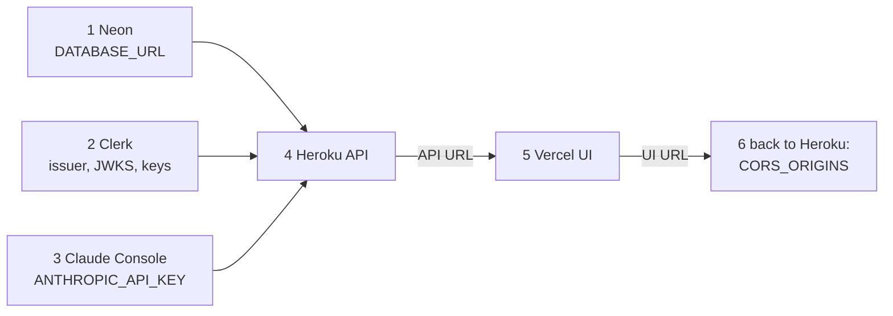

# Deployment

Do [revival-plan.md](revival-plan.md) steps 1–4 first. Then set things up in this order, because each service needs values from the one before it.



## 1. Neon (database)

1. Sign up at neon.tech, then create a project (choose a region near Heroku's US region, e.g. `us-east-1`).
2. Copy the **direct** connection string (not the "pooled" one). Change the start to `postgresql+asyncpg://` and keep `?sslmode=require`.
3. Optional: create a branch named `dev` for local work, so experiments never touch the live data.

## 2. Clerk (auth)

1. Create an application at dashboard.clerk.com. Turn on Email and Google sign-in.
2. From **API Keys**, copy the publishable key, the secret key and the Frontend API URL.
   - `CLERK_ISSUER` = the Frontend API URL, e.g. `https://xxx.clerk.accounts.dev`
   - `CLERK_JWKS_URL` = `<issuer>/.well-known/jwks.json`
3. **Sessions → Customize session token:** `{"role": "{{user.public_metadata.role}}"}`
4. After your first sign-in, open **Users → you → Metadata → Public** and set `{"role": "admin"}`.

## 3. Claude

1. Create an account at platform.claude.com and add a small amount of credit.
2. Set a monthly spend limit.
3. Create an API key for the app, and a separate one for local dev, so you can revoke one without breaking the other.

## 4. Heroku (API)

```bash
cd edu-tech-backend
heroku create edutech-api            # or reuse your existing app
heroku stack:set heroku-24
heroku ps:type web=basic             # or eco while building alone

heroku config:set \
  APP_ENV=prod LOG_LEVEL=INFO \
  DATABASE_URL='postgresql+asyncpg://…neon.tech/neondb?sslmode=require' \
  CLERK_ISSUER='https://xxx.clerk.accounts.dev' \
  CLERK_JWKS_URL='https://xxx.clerk.accounts.dev/.well-known/jwks.json' \
  ANTHROPIC_API_KEY='sk-ant-…' CLAUDE_MODEL='claude-opus-5-5' \
  CORS_ORIGINS='http://localhost:3000' \
  ENABLE_STUDY_BUDDY=0 ENABLE_LEARNING_MATERIALS=0

git push heroku main                 # the release phase runs: alembic upgrade head
heroku logs --tail
curl https://edutech-api-xxxx.herokuapp.com/health
```

Background job safety net:

```bash
heroku addons:create scheduler:standard
heroku addons:open scheduler          # add job: python run_worker.py, every 10 minutes
```

Never run `heroku ps:scale web=2`, and never add `--workers`. The live quiz needs one process ([architecture.md §3.2](architecture.md#32-take-an-adaptive-quiz-live-stream)).

### API env vars

| Var | Required | Example / note |
|---|---|---|
| `DATABASE_URL` | yes | `postgresql+asyncpg://…?sslmode=require` |
| `CLERK_ISSUER` | yes | Clerk Frontend API URL |
| `CLERK_JWKS_URL` | yes | `<issuer>/.well-known/jwks.json` |
| `CORS_ORIGINS` | yes | comma list: `https://edutech.vercel.app,http://localhost:3000` |
| `ANTHROPIC_API_KEY` | yes | after step 4 of the revival plan |
| `CLAUDE_MODEL` | no | default `claude-opus-5-5` |
| `ENABLE_STUDY_BUDDY` | no | `1` mounts the chatbot routes |
| `ENABLE_LEARNING_MATERIALS` | no | `1` mounts learning-material routes |
| `SSE_HEARTBEAT_SECONDS` | no | default 10. Must stay under 55 on Heroku. |
| `LOG_LEVEL`, `APP_ENV` | no | `INFO`, `prod` |

## 5. Vercel (UI)

1. Import the `edu-tech-ui` GitHub repo. Vercel detects Next.js, so leave the build settings as they are.
2. Set the env vars below, then deploy.

### UI env vars

| Var | Value |
|---|---|
| `NEXT_PUBLIC_API_BASE_URL` | `https://edutech-api-xxxx.herokuapp.com` (no trailing slash) |
| `NEXT_PUBLIC_CLERK_PUBLISHABLE_KEY` | `pk_…` |
| `CLERK_SECRET_KEY` | `sk_…` (used by `clerkMiddleware`) |

## 6. Close the loop

1. Add the Vercel URL to Heroku: `heroku config:set CORS_ORIGINS='https://<your>.vercel.app,http://localhost:3000'`.
2. In Clerk, add the Vercel domain under **Domains / allowed origins** if it asks.
3. Smoke test:
   - Sign in, and check that the dashboard loads (`/me` works, so auth and CORS work).
   - As admin, open `/admin/topics` and create a topic, then watch `/admin/jobs` go queued → running → succeeded within about a minute.
   - Take a quiz. Questions arrive, the difficulty changes after 3 right or 3 wrong in a row, and the review page shows your answers.

## Local development

```bash
# API
cd edu-tech-backend
python3.11 -m venv .venv && source .venv/bin/activate
pip install -r requirements.txt -r requirements-dev
touch .env                    # same vars as the table above, pointing at your Neon dev branch
alembic upgrade head
uvicorn app.main:app --reload --port 8000     # docs at http://localhost:8000/docs
python run_worker.py                           # drain one job by hand

# UI
cd edu-tech-ui
npm install
cp env.example .env.local      # NEXT_PUBLIC_API_BASE_URL=http://localhost:8000 + Clerk keys
npm run dev                    # http://localhost:3000
```
