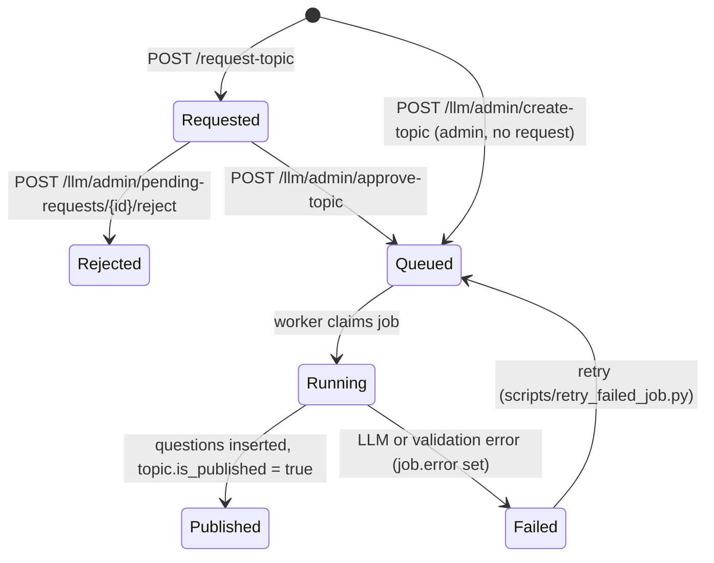

# Topics and question generation

**In one line:** learners ask for a topic, an admin approves it, and a worker asks the LLM for 20 questions and saves them.

## Topic lifecycle

## Learner side

- `GET /topics` lists published, non-deleted topics, with `question_count`.
- `GET /search?q=` matches published topics by name or slug. If nothing matches, and the query is at least 3 characters, it returns a "request this topic?" prompt.
- `POST /request-topic {topic_name}` inserts `pending_topics` (unique per slug), so asking twice does nothing new.

## The worker

`app/features/llm/worker.py` → `run_once(max_jobs)`:

1. **Claim.** In a transaction, pick the oldest `queued` job with `FOR UPDATE SKIP LOCKED`, set it to `running`, log `LLM_JOB_RUNNING`.
2. **Dispatch** by `job_type`:
   - `generate_topic` (default) → `_process_job`
   - `learning_material_generation` → `handler_learning_materials.py`
   - `study_buddy_reply` / `study_session_summary` → `handler_study_reply.py`
3. **Generate** (`_process_job`): make sure the topic row exists, commit, then call the LLM (`tenacity` retries the call up to 3 times). Ask for 20 questions.
4. **Validate** with `TopicQuestionsArtifact` (`app/features/llm/schema.py`). This checks 4 choices, a correct answer of A–D, difficulty 1–5, and explanations for every choice.
5. **Save**: `bulk_upsert_questions` (skips rows whose `question_hash` already exists), publish the topic, delete the pending request, set the job to `succeeded` with `created_count`.
6. **On any error**, set the job to `failed` with the message.

Who runs it:

- **Right away:** `approve-topic` and `create-topic` add `trigger_worker_async` as a FastAPI background task, so it runs in the web process after the response is sent.
- **Safety net:** Heroku Scheduler runs `python run_worker.py` every 10 minutes ([decisions.md §2](../decisions.md#2-api--heroku)).

## The prompt

`prompts/llm_topic_questions.py` holds the system prompt. It asks for a topic description, tags, and a spread of difficulties with an explanation per choice, as one JSON object. With Claude's structured output ([revival-plan.md](../revival-plan.md) step 4), the "return ONLY JSON" instructions and the fence stripping in the provider are no longer needed. The schema is enforced by the API.

## Learning materials (flagged off)

Behind `ENABLE_LEARNING_MATERIALS=1`. `POST /learning-content/admin/learning-materials/generate` (or `…/topics/{topic_uid}/materials/generate`) queues a `learning_material_generation` job. The handler asks the LLM for sectioned study notes and stores them in `learning_materials` and `learning_sections`. Learners read them with `GET /learning-content/topics/{topic_uid}/materials` or `GET /learning-content/learning-materials/{topic_slug}`. It is built and tested against a mock, but no UI uses it yet.

Note: `app/api/routes.py` mounts this router under `/learning-content` **always**. `routes_study_buddy.py` mounts it a second time, without the prefix, when the flag is on. Keep one of the two.

## Admin tools

- `GET /llm/admin/jobs`: job list (UI: `/admin/jobs`)
- `scripts/inspect_jobs.py`, `scripts/retry_failed_job.py`, `scripts/publish_all_topics.py`: run locally against the live database
