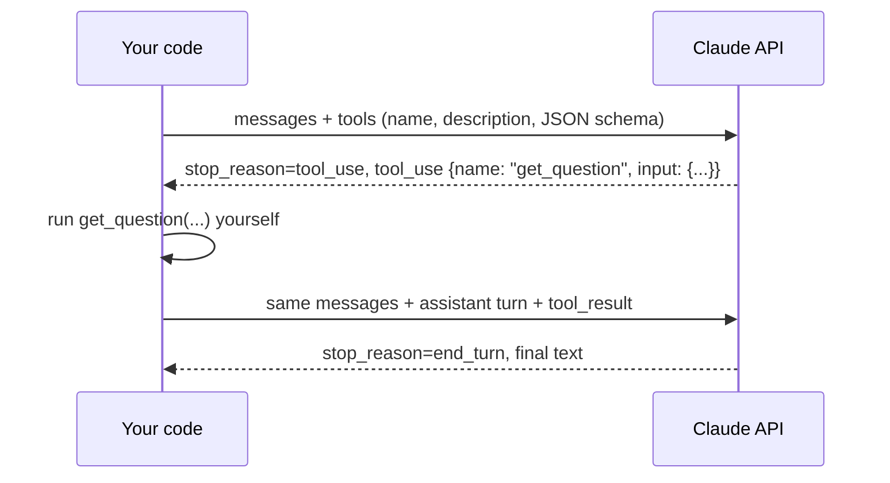

# 2. Tools and agents

Goal: let Claude **ask your code for information or actions**, for example "look up this question" or "get this learner's quiz history", instead of you cramming everything into the prompt up front.

## 2.1 What "tool use" really is

Claude never runs your code. The exchange goes like this:



A **tool** is just a name, a description and an input schema. Claude reads the description to decide when to call it, so write it as carefully as a prompt.

An **agent** is this loop running until Claude stops asking for tools. It is the model, not your code, that decides which tools to call and in what order.

## 2.2 Should this be an agent?

Usually not. Pick the simplest option that works:

| Shape | Use when | Example in this app |
|---|---|---|
| One call | Input known up front, one output | Generate 20 questions for a topic |
| Workflow (your code runs fixed steps) | Steps are known in advance | Load the question, then call Claude, then check for leaks |
| Agent (Claude picks the tools) | What to look up depends on what the learner says | A tutor that decides whether it needs the question, past mistakes or study notes |

The question generator should stay a single call. The tutor is the one place where tools pay off.

## 2.3 The easy way: the tool runner

The SDK can run the loop for you. Define tools as typed Python functions, and the docstring becomes the description:

```python
import anthropic
from anthropic import beta_async_tool

client = anthropic.AsyncAnthropic()

def make_tutor_tools(db, user_id, mode):
    """Build tools bound to this request's DB session and user.
    The model never chooses user_id, so a learner can only see their own data."""

    @beta_async_tool
    async def get_question(question_id: str) -> str:
        """Get the stem and choices of a quiz question the learner is working on.

        Args:
            question_id: UUID of the question.
        """
        q = await load_question(db, question_id)
        data = {"body": q.body, "choices": q.choices, "difficulty": q.difficulty}
        if mode != "quiz":                      # never hand the answer over in quiz mode
            data["correct_answer"] = q.correct_answer
            data["explanations"] = q.explanations
        return json.dumps(data)

    @beta_async_tool
    async def get_recent_mistakes(topic_id: str, limit: int = 5) -> str:
        """List questions this learner recently got wrong in a topic.

        Args:
            topic_id: UUID of the topic.
            limit: How many to return (max 10).
        """
        rows = await recent_wrong_attempts(db, user_id, topic_id, min(limit, 10))
        return json.dumps([{"body": r.body, "picked": r.selected_answer} for r in rows])

    return [get_question, get_recent_mistakes]


runner = client.beta.messages.tool_runner(
    model="claude-opus-5-5",
    max_tokens=4000,
    system=TUTOR_SYSTEM_PROMPT,
    tools=make_tutor_tools(db, user_id, mode),
    messages=history + [{"role": "user", "content": learner_message}],
)
async for message in runner:   # one item per model turn; stops when Claude is done
    last = message
reply = next(b.text for b in last.content if b.type == "text")
```

`load_question` and `recent_wrong_attempts` are small repository functions you would add to `app/db/repositories.py`.

## 2.4 The manual loop (to see what the runner does)

Write it once by hand. It makes everything else clear:

```python
messages = [{"role": "user", "content": learner_message}]
while True:
    response = await client.messages.create(
        model="claude-opus-5-5", max_tokens=4000,
        system=TUTOR_SYSTEM_PROMPT, tools=TOOL_SCHEMAS, messages=messages,
    )
    if response.stop_reason != "tool_use":
        break
    messages.append({"role": "assistant", "content": response.content})   # keep ALL blocks
    results = []
    for block in response.content:
        if block.type == "tool_use":
            try:
                out = await run_tool(block.name, block.input)
                results.append({"type": "tool_result", "tool_use_id": block.id, "content": out})
            except Exception as e:
                results.append({"type": "tool_result", "tool_use_id": block.id,
                                "content": str(e), "is_error": True})
    messages.append({"role": "user", "content": results})   # all results in ONE message
```

Here `TOOL_SCHEMAS` is a plain list:

```python
TOOL_SCHEMAS = [{
    "name": "get_question",
    "description": "Get the stem and choices of a quiz question the learner is working on.",
    "input_schema": {
        "type": "object",
        "properties": {"question_id": {"type": "string", "description": "UUID of the question"}},
        "required": ["question_id"],
        "additionalProperties": False,
    },
    "strict": True,   # Claude's input is guaranteed to match the schema
}]
```

Rules worth remembering:

- Append the **whole** `response.content` as the assistant turn, not just the text. Opus 5.5 returns thinking blocks that must go back unchanged.
- Claude may call several tools at once. Return all the results together in one user message.
- A failing tool should return `is_error: True`, not crash the loop. Claude will usually recover.
- Put a cap on iterations (say, 5) so a confused model cannot loop forever and run up costs.

## 2.5 Safety rules for tools

- **Tool input is untrusted.** Claude writes it, possibly steered by what a learner typed. Validate IDs and clamp limits.
- **Bind identity on the server.** The user id comes from the JWT (`request.state.user`), never from a tool argument.
- **Read-only first.** Give the tutor tools that read. A tool that writes (for example "mark mastered") needs a reason and a check.
- **Withhold, don't redact.** In quiz mode, the safest leak protection is never giving the model the correct answer at all (see `get_question` above).

## Exercises

1. In a scratch script, give Claude a fake `get_weather` tool. Print every `stop_reason` and `tool_use` block in the manual loop.
2. Add `get_question` against your Neon dev branch. Ask "help me with question <uuid>" and watch Claude call it.
3. Ask, in quiz mode, "just tell me the answer". Confirm it cannot: it never received the answer.
4. Swap your manual loop for the tool runner, and compare the line counts.

Next: [03-mcp.md](03-mcp.md). The same tools, served through a standard protocol so *any* MCP client (Claude Code, Claude Desktop, your own code) can use them.
