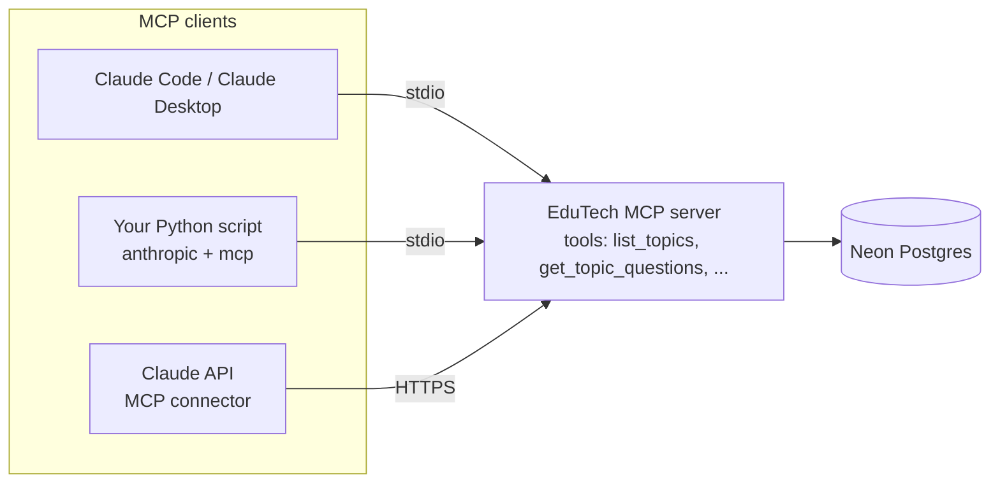

# 3. MCP: Model Context Protocol

Goal: understand MCP, build an MCP server for EduTech, and connect Claude to it in three different ways.

## 3.1 What MCP is

In [02-tools-and-agents.md](02-tools-and-agents.md), your tools lived inside your own Python code, and only your code could use them. **MCP is a standard plug** for tools. You write the tools once as an **MCP server**, and any **MCP client** can discover and call them. Clients include Claude Code, Claude Desktop, the Claude API, and your own scripts.



A server can offer three kinds of things:

| Kind | What it is | EduTech example |
|---|---|---|
| **Tools** | functions the model can call | `list_topics()`, `get_topic_questions(slug)` |
| **Resources** | read-only data the client can load | `topic://algebra-basics` returning the topic description |
| **Prompts** | reusable prompt templates | "Make a study plan for {topic}" |

How client and server talk (the **transport**):

- **stdio:** the client starts the server as a child process and talks over stdin/stdout. Local only, no network and no auth. Best for learning.
- **Streamable HTTP:** the server is a web endpoint (e.g. `https://…/mcp`). Needed for the Claude API connector, and for anything remote.

## 3.2 Build the EduTech MCP server

```bash
pip install "mcp[cli]"
```

```python
# mcp_server.py  (repo root)
import json
from mcp.server.fastmcp import FastMCP

from app.db.base import SessionLocal
from app.db.repositories import list_topics as repo_list_topics

mcp = FastMCP("edutech")


@mcp.tool()
async def list_topics(search: str | None = None) -> str:
    """List published EduTech topics, optionally filtered by a search term."""
    async with SessionLocal() as db:
        result = await repo_list_topics(db, q=search, published_only=True, limit=50, offset=0)
    return json.dumps([{"name": t.name, "slug": t.slug, "description": t.description}
                       for t in result["items"]])


@mcp.tool()
async def get_topic_questions(slug: str, difficulty: int | None = None) -> str:
    """Get quiz questions (stem, choices, difficulty) for a topic slug. No answers included."""
    ...  # small query on Question joined to Topic; leave out correct_answer


if __name__ == "__main__":
    mcp.run()          # stdio by default
```

The function name becomes the tool name, the type hints become the input schema, and the docstring becomes the description. This is the same idea as `@beta_async_tool`.

Try it with the inspector (a small web UI that lists and calls your tools):

```bash
mcp dev mcp_server.py
```

> The `mcp` SDK changes quickly. If an import fails, check the README at github.com/modelcontextprotocol/python-sdk for the current `FastMCP` API.

## 3.3 Connection A: Claude Code (or Claude Desktop)

The fastest win. You can then ask Claude Code questions about your live data.

```bash
claude mcp add edutech -- /path/to/edu-tech-backend/.venv/bin/python /path/to/edu-tech-backend/mcp_server.py
```

Then, in Claude Code: *"Which EduTech topics have no difficulty-5 questions?"* Claude calls `list_topics` and `get_topic_questions` and answers. `DATABASE_URL` must be in the environment, or in the backend `.env`, which `app/config.py` loads.

For Claude Desktop, add the same command and arguments to its config file under `mcpServers`.

## 3.4 Connection B: your own Python code (local server)

The SDK can turn MCP tools into tool-runner tools. This is how *your app* could use any MCP server:

```bash
pip install "anthropic[mcp]"
```

```python
import asyncio
from anthropic import AsyncAnthropic
from anthropic.lib.tools.mcp import async_mcp_tool
from mcp import ClientSession
from mcp.client.stdio import stdio_client, StdioServerParameters

async def main():
    client = AsyncAnthropic()
    params = StdioServerParameters(command="python", args=["mcp_server.py"])
    async with stdio_client(params) as (read, write):
        async with ClientSession(read, write) as mcp_client:
            await mcp_client.initialize()
            tools = (await mcp_client.list_tools()).tools
            runner = client.beta.messages.tool_runner(
                model="claude-opus-5-5",
                max_tokens=4000,
                messages=[{"role": "user", "content": "Suggest 3 topics for a beginner, with reasons."}],
                tools=[async_mcp_tool(t, mcp_client) for t in tools],
            )
            async for message in runner:
                print(message.content)

asyncio.run(main())
```

Your code is the MCP client here. Claude decides which tools to call, and the SDK forwards each call to the server.

## 3.5 Connection C: the Claude API calls a remote server for you

If the server is on the public internet over HTTPS, you can skip the client code. The **MCP connector** lets Anthropic's side call the server directly:

```python
response = await client.beta.messages.create(
    model="claude-opus-5-5",
    max_tokens=4000,
    betas=["mcp-client-2025-11-20"],
    mcp_servers=[{
        "type": "url",
        "url": "https://edutech-api-xxxx.herokuapp.com/mcp",
        "name": "edutech",
        "authorization_token": MCP_TOKEN,      # your server must check this
    }],
    tools=[{"type": "mcp_toolset", "mcp_server_name": "edutech"}],   # both halves are required
    messages=[{"role": "user", "content": "What topics exist?"}],
)
```

To get there:

1. Serve the same `FastMCP` over HTTP: `mcp.run(transport="streamable-http")`, or mount its app inside FastAPI at `/mcp`.
2. **Add auth before deploying.** Without it, anyone can read your data. The simplest option is a shared secret checked as a Bearer token. The proper option is to verify the caller's Clerk JWT, the same way `clerk_auth_dependency` does, so tools only see that user's data.
3. Keep the tools read-only until auth is solid.

## 3.6 Which one when?

| You want | Use |
|---|---|
| To explore your own data while developing | A: Claude Code + stdio |
| Your app to use someone else's MCP server (e.g. a docs or search server) | B: `anthropic[mcp]` helpers, or C if the server is remote |
| Other people's Claude clients to use EduTech | Deploy the server over HTTP with auth, and they add it as a remote server |

## Exercises

1. Build `mcp_server.py` with `list_topics`. Run `mcp dev`, call it from the inspector, and see JSON come back.
2. Add `get_topic_questions`, then add the server to Claude Code. Ask it to find topics with an uneven difficulty spread.
3. Add a resource, `topic://{slug}`, and a prompt, `study_plan(topic)`. See how Claude Code offers them.
4. Write the section 3.4 script and make Claude pick a topic using your server.
5. Stretch goal: serve over HTTP locally, put a shared-secret check in front, and call it with the section 3.5 connector through a tunnel (e.g. `cloudflared`).
