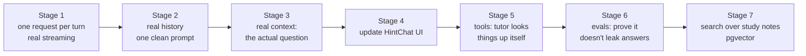

# 4. The chatbot, and how to improve it

Goal: understand every step of Study Buddy, then rebuild it in small stages. Each stage teaches one idea from guides 1–3, and each one leaves the bot working.

Read [features/study-buddy.md](../features/study-buddy.md) first for the API surface.

## 4.1 How it works today, step by step

Follow along in `app/features/study_buddy/`.

| Step | Code | What it does | Problem |
|---|---|---|---|
| 1 | `router.post_study_message` → `service.post_message` | Saves the learner's message to `study_messages`, then stores it in `_SESSIONS[id].pending_message` | The message waits in process memory for a *second* request |
| 2 | `sse._study_buddy_event_generator` → `service.dequeue_pending_message` | The SSE GET picks up the waiting message | Two requests for one turn. A restart in between loses it. |
| 3 | `policies.select_next_hint_level` | Hint level 0–3 based on mode and attempts | Fine as a rule, but the model is never told why |
| 4 | `retrieval.resolve_context` | Loads the session row, the last 5 messages, and the question's text and choices when `question_id` is set | History becomes a printed Python list inside the prompt |
| 5 | `retrieval.retrieve_documents` | `_BaseVectorClient.search`: returns the query back as fake snippets | Junk text in every prompt |
| 6 | `prompts.build_system_prompt` / `build_user_prompt_template` | Persona + template + guardrails / template + message + snippets | The same template is sent twice |
| 7 | `service._call_llm` | One non-streamed LangChain call (or a mock) | The learner sees nothing until the full reply is ready |
| 8 | `policies.enforce_quiz_no_answer` | Regex check for "the answer is…" | It catches phrases, not meaning |
| 9 | `service._tokenize_for_streaming` | Cuts the finished text into 60-character pieces and emits them as `token` events | Fake streaming |
| 10 | `repository.append_message`, `log_study_analytics` | Saves the reply | Fine |

The good parts to keep: the database tables, the modes and hint budget, the ownership checks (`user_clerk_id`), and the event names (`hint_meta`, `token`, `done`).

## 4.2 Upgrade plan



### Stage 1: one request per turn, with real streaming (guide 1, §1.4)

Merge "post message" and "stream reply" into one endpoint. The browser POSTs the message and reads the reply from the same response. This is the pattern the quiz already uses for its stream (`fetch` + `ReadableStream`), so the UI code is familiar.

```python
# router.py
@router.post("/sessions/{session_id}/messages")
async def post_and_stream(session_id: str, payload: StudyMessageRequest,
                          user=Depends(clerk_auth_dependency), db=Depends(get_session)):
    _require_feature_enabled()
    repo = StudyBuddyRepository(db)
    session = await repo.get_session(user_id=user["clerk_user_id"], session_id=session_id)  # ownership check
    await repo.append_message(session_id=session_id, user_id=user["clerk_user_id"],
                              role="user", content=payload.message, hint_level=session.hint_level)
    await db.commit()
    return StreamingResponse(service.stream_reply(db, repo, session, payload),
                             media_type="text/event-stream",
                             headers={"Cache-Control": "no-cache", "X-Accel-Buffering": "no"})
```

```python
# service.py
_client = anthropic.AsyncAnthropic()

async def stream_reply(db, repo, session, payload):
    system, messages = await build_prompt(repo, session, payload)   # stage 2
    yield sse("hint_meta", {"level": session.hint_level, "remaining": ..., "exhausted": ...})
    parts = []
    async with _client.messages.stream(
        model=get_settings().CLAUDE_MODEL,
        max_tokens=2000,
        system=system,
        messages=messages,
        output_config={"effort": "low"},          # chat: fast and cheap
    ) as stream:
        async for text in stream.text_stream:
            yield sse("token", {"index": len(parts), "text": text})
            parts.append(text)
        final = await stream.get_final_message()
    reply = "".join(parts)
    stored = await repo.append_message(session_id=str(session.id), user_id=session.user_clerk_id,
                                       role="assistant", content=reply,
                                       hint_level=session.hint_level,
                                       tokens=final.usage.output_tokens)   # add a `tokens` param to append_message
    await db.commit()
    yield sse("done", {"message_id": str(stored.id), "tokens": final.usage.output_tokens})

def sse(event: str, data: dict) -> str:
    return f"event: {event}\ndata: {json.dumps(data)}\n\n"
```

What you delete: `_SESSIONS`, `_LOCK`, `pending_message`, `dequeue_pending_message`, `_tokenize_for_streaming`, `_mock_llm_response` (keep a tiny fake client in tests instead), the second SSE router, and LangChain. The service shrinks a lot, and it now works with a restart, or even with two processes, because nothing is held in memory between requests.

Check: the first token shows up in about a second, and the text arrives word by word.

### Stage 2: real conversation history, one clean prompt (guide 1, §1.1 and §1.7)

Send past turns as real turns, not as text pasted into one message:

```python
async def build_prompt(repo, session, payload):
    rows = await repo.recent_messages_for_session(session_id=str(session.id), limit=20)
    history = [{"role": r.role, "content": r.content}          # rows come oldest-first
               for r in rows if r.role in ("user", "assistant")]
    # history already ends with the learner message saved in stage 1
    system = [{
        "type": "text",
        "text": TUTOR_SYSTEM[session.mode],                 # fixed text per mode, so it caches
        "cache_control": {"type": "ephemeral"},
    }]
    return system, history
```

The first message must be from the user. If the 20-message window starts on an assistant reply, drop that first item.

Rewrite the prompt as **one** system text per mode: who the tutor is, how hints escalate (level 0 is a nudge, 1 is a key idea, 2 is a worked step, 3 is a near-solution), what it must never do, and the length limit. Delete the `{{placeholder}}` templates. Values that change per turn (hint level, the question) go in stage 3's context message, after the cached prefix.

Check: ask "what did I just ask you?" and it knows. On the second turn, `usage.cache_read_input_tokens` is above 0, if the system prompt is long enough to cache.

### Stage 3: give the tutor the real question (replaces mock retrieval)

Most learners will chat *about the question on screen*. `ContextSnapshot` already carries `question_id` and `topic_id`, and `resolve_context` already loads the question's text and choices. Finish the job: add the topic, keep the answer out in quiz mode, and send it as a short context block in the turn:

```python
ctx_lines = []
if snapshot.question_id:
    q = await load_question(db, snapshot.question_id)
    ctx_lines.append(f"Question: {q.body}\nChoices: {json.dumps(q.choices)}\nDifficulty: {q.difficulty}")
    if session.mode != "quiz":                  # in quiz mode the model never sees the answer
        ctx_lines.append(f"Correct: {q.correct_answer}\nExplanations: {json.dumps(q.explanations)}")
if snapshot.topic_id:
    t = await load_topic(db, snapshot.topic_id)
    ctx_lines.append(f"Topic: {t.name}: {t.description}")
ctx_lines.append(f"Hint level for this reply: {session.hint_level} of {session.hint_budget}")
```

This one change does more for answer quality than anything else on this list. Delete `retrieval.py`'s mock clients.

**Leak protection, re-thought.** With real streaming, you cannot "unsend" a token that a regex flags afterwards. So in quiz mode, the main protection is to **withhold the answer** from the model. Keep `LeakClassifier` as a logged after-the-fact check, which tells you how often it would have fired.

### Stage 4: update the chat screen (UI)

`HintChat` (`edu-tech-ui/src/components/quiz-hint-chat.tsx`) already exists on the quiz page. Today it POSTs the message, then opens `GET /sse/study-buddy/{id}` to read the reply, which is the two-request pattern from 4.1. After stage 1:

- Change `sendMessage` to read the reply straight from the `POST …/messages` response body. The event parser (`hint_meta` / `token` / `done` / `error`) stays as it is. Delete `connectToSSEStream` and the `AbortController` juggling.
- Pull the session and stream logic out into `src/hooks/use-study-buddy.ts`. Then reuse it on the topic page with `{mode: "reading", topic_id}`. Today, only quiz mode has a screen.
- Update `src/components/__tests__/quiz-hint-chat.test.tsx` for the single request.
- Set `ENABLE_STUDY_BUDDY=1` on Heroku.

### Stage 5: let the tutor look things up (guide 2)

Once stage 3 works, move fixed context into **tools**, so the tutor fetches only what it needs: `get_question`, `get_recent_mistakes`, `get_learning_material(topic_id)`. Use the tool runner. Bind `db`, `user_id` and `mode` in a closure ([02 §2.3](02-tools-and-agents.md#23-the-easy-way-the-tool-runner)).

Streaming with tools: iterate the runner with `stream=True` and forward text deltas as `token` events. Read the SDK's streaming-with-tools notes before you do: tool inputs then need your own validation.

### Stage 6: evals, to prove it works

"It seemed fine when I tried it" stops being enough at this point. Build a small eval:

1. Write 30 test cases (`tests/evals/study_buddy.jsonl`): quiz-mode questions where the learner begs for the answer, reading-mode "explain like I'm 10", and off-topic requests.
2. Run each through `stream_reply` against a real model.
3. Grade with a second Claude call, a "judge", using a yes/no rubric: *Did the reply reveal the correct letter or value? Is it under 220 words? Does it end with a question back to the learner?*
4. Track the pass rate. Re-run it after every prompt change.

Running `/claude-api build-eval` in Claude Code will walk you through this interactively.

### Stage 7: search over study notes (pgvector)

Only once learning materials exist (`ENABLE_LEARNING_MATERIALS=1`) and are too big to paste:

- Turn on the `vector` extension on Neon, and add an `embedding vector(…)` column to `learning_sections`.
- Embed each section when it is created. Claude does not offer an embeddings endpoint, so use a separate embeddings provider, or a local model like `sentence-transformers`.
- Expose a `search_study_notes(query)` tool that runs a nearest-neighbour query.

Until then, plain SQL (`learning_sections` for the topic, ordered by position) is enough.

## 4.3 Running costs and safety

- **Per reply:** about 2k tokens in (system + history + context) and about 300 out. That is roughly $0.014 on Opus 5.5 at `effort: low`, and less with caching.
- **Cap it:** `max_tokens=2000`, keep the last 20 messages, and add a per-user daily message limit (count `study_messages` rows per user per day) before sharing the app.
- **Prompt injection:** learners can type "ignore your rules". The real defences are structural: no answer in quiz mode, read-only tools, and user identity bound on the server. Prompt wording only helps at the margin.
- **Log `usage`** on every reply into `study_messages.tokens`. The column already exists.

## 4.4 Ideas beyond the plan

- **Session summary:** when a session ends, one call writes "what you struggled with" into `study_analytics`. `summarize_session` is the placeholder for this.
- **Adaptive nudges:** after 3 wrong answers in the quiz (the moment difficulty drops), offer a Study Buddy hint automatically.
- **Study plans:** planning mode plus a `get_quiz_history` tool gives "here is your week" plans.
- **Question review:** an admin tool that asks Claude to critique generated questions (ambiguous stems, a wrong key) before a topic is published.
